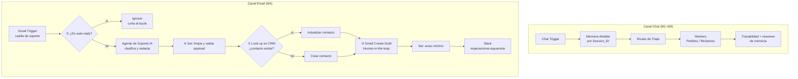

# 🤖 Proyecto Integrador · AI Automation Avanzado (Coderhouse)

**Autora del proyecto:** Joselin Pereira

**Hito actual:** Checkpoint 4 · Integraciones avanzadas e interconexión de sistemas (M4)

**Archivo de entrega:** [`checkpoint4_joselin_pereira.json`](./checkpoint4_joselin_pereira.json)

---

## 📌 El caso: Aqua, asistente de pedidos y soporte de AquaNorte

AquaNorte es una empresa de reparto a domicilio de agua purificada en bidones y alquiler de dispensers. **Aqua** es su sistema multi-agente de atención: toma pedidos y reclamos por chat, recuerda a cada cliente entre sesiones y, desde este hito, también atiende la **casilla de soporte por email**, sincronizado con el CRM y con el canal del equipo de operaciones.

---

## 🧠 Arquitectura del flujo (M4)

El workflow tiene **dos canales de entrada** sobre la misma red de agentes:

### Los 4 controles de la rúbrica

| # | Nodo | Qué previene |
|---|---|---|
| ① | **¿Es Auto-Reply?** (IF inmediatamente después del trigger) | Bucle infinito de respuestas automáticas: ignora asuntos *Auto-reply, Out of office, Fuera de la oficina, Respuesta automática, Undeliverable, Delivery Status Notification*, remitentes *no-reply / mailer-daemon / postmaster*, encabezados `Auto-Submitted` / `Precedence: bulk` y correos enviados por la propia casilla |
| ② | **Buscar Contacto en CRM (Look up)** → ¿Contacto Existe? → Actualizar / Crear | Error 409 por contactos duplicados: siempre se busca por email antes de crear |
| ③ | **Crear Borrador (HITL)**: Gmail *Create Draft* | Envíos sin supervisión: la IA nunca envía, deja el borrador en la conversación original para aprobación humana |
| ④ | **Limpiar y Validar Payload** (Set) + ¿Email Válido? | Error 400 por payload mal formado: deja solo email, nombre, asunto, texto recortado y resultado de la IA, y valida el email antes de tocar el CRM. Un segundo Set limpia el aviso antes de Slack |

---

## 🔐 Integraciones OAuth2 y mínimo privilegio

| Herramienta | Rol | Credencial | Alcance aplicado |
|---|---|---|---|
| **Airtable (base "AquaNorte CRM")** | CRM / fuente única de verdad del cliente | Airtable OAuth2 (integración propia) | Scopes `data.records:read`, `data.records:write`, `schema.bases:read`; acceso concedido **solo a la base del CRM**; dominio permitido `api.airtable.com` |
| **Gmail (casilla de soporte dedicada)** | Entrada de correos y borradores de respuesta | Gmail OAuth2 | Casilla aislada de pruebas; el trigger filtra `to:` la casilla y solo no leídos; la respuesta al cliente es **solo borrador**; dominios permitidos de Google API |
| **Slack (#operaciones-aquanorte)** | Canal del equipo de operaciones | Slack OAuth2 | El flujo solo publica mensajes en un canal; el contenido pasa antes por un Set que envía únicamente el resumen necesario |

**Separación de datos:** la memoria de sesiones (M3) y el CRM viven en **bases distintas de Airtable**, cada una con su propia credencial. Así, un acceso no expone los datos del otro.

### ¿Por qué Airtable como CRM?

La consigna aclara que importa *el rol de cada pieza, no la marca*. Airtable cumple el rol de CRM: tabla de contactos con el email como clave única, historial de interacciones (categoría, asunto, resumen de la IA, cantidad de contactos, último contacto) y estado del cliente. Su uso fue **consultado y autorizado** por el equipo docente.

**Esquema de la tabla `Contactos`:** Email (clave), Nombre, Origen, Ultima_Categoria, Estado_Cliente, Ultimo_Asunto, Resumen_IA, Cantidad_Contactos, Ultimo_Contacto, Fecha_Alta (automático).

---

## ✅ Test de regresión

| # | Prueba | Resultado |
|---|---|---|
| 1 | Correo de pedido desde un remitente nuevo | Contacto **creado** en el CRM, borrador en el hilo original, aviso en Slack |
| 2 | Segundo correo (reclamo) del mismo remitente | Contacto **actualizado** sin duplicar (Cantidad_Contactos = 2), aviso con *Requiere atención humana* |
| 3 | Correo con asunto *Respuesta automática: Fuera de la oficina* | **Ignorado** por el IF: sin contacto, borrador ni aviso |
| 4 | Conversación por chat (regresión del canal M1–M3) | Router, Workers y memoria funcionando con los nuevos delimitadores de contexto |

---

